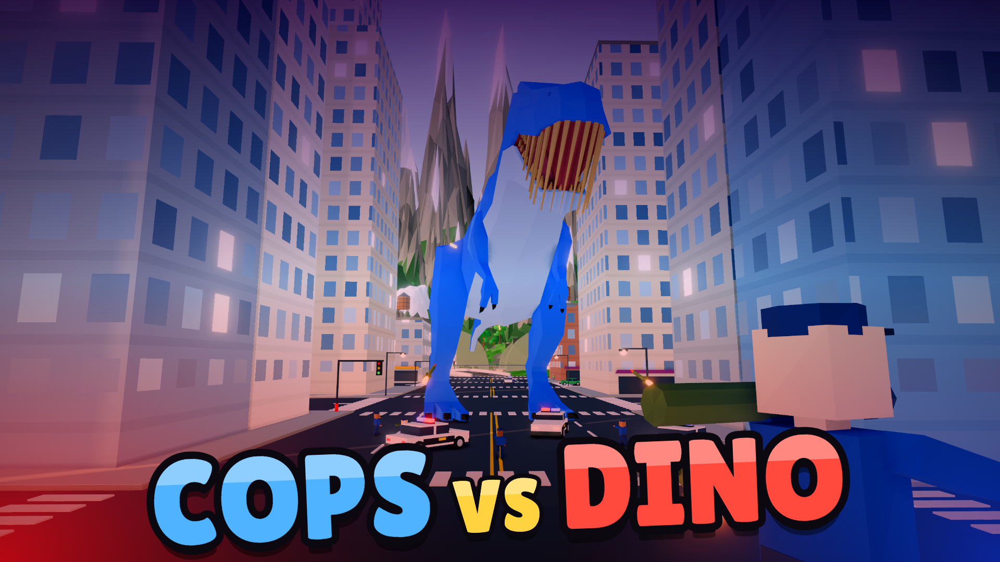

# Dino Muncher 🦖

**Cops vs Dino.** Start as a tiny dinosaur, eat everything in sight, and grow into a giant T-Rex that tears cities apart. Or play as the humans and try to bring the monster down.

Dino Muncher is a free low-poly multiplayer game that runs right in your browser. There's nothing to download or install.

▶ **Play now:** https://mrratburnfailedme.github.io/dino-muncher/



## How it plays

**As the dino**, you hatch small and have to eat animals, people, cars, boats and trees to grow. The bigger you get, the more you can eat:

- **Big dinos crush** anything tiny just by walking over it.
- **They smash** through houses.
- **They rip** whole buildings out of the ground and throw them.

The city fights back. Wreck too much and the police show up with pistols and rocket launchers. You take 2.5× damage in the city, so you'll need to hit and run. Go too far and the military arrives with soldiers, tanks, fighter jets and missile launchers.

**As a human**, you start as a cop in a squad. You can:

- Shoot dinos with pistols, shotguns and rifles.
- Carjack any vehicle, drive police cars and tanks, or fly a fighter jet.
- Eject with a parachute.

Every point of damage you deal earns score, but don't hurt civilians or you'll be wanted yourself.

## Features

- Online multiplayer: dinos and humans in the same world.
- A big open map with:
  - a downtown city
  - suburbs
  - a power plant
  - a castle
  - a military base
  - forests
  - lakes
  - the ocean
- Five dino abilities that unlock as you grow: Ground Pound, Roar, Tail Whip, Earthquake, and Rip & Throw (Godzilla mode).
- Police and army that escalate the more chaos you cause.
- Drivable cars, police cars and tanks, plus a flyable F-14 with missiles.
- Rainbow "?" power-up boxes that spawn around the map.
- Ten dino skins, a tutorial island for new players, and its own music and sound effects.

## Controls

| Key | Dino | Human |
| --- | --- | --- |
| **WASD** | Move | Move / drive |
| **Mouse** | Look | Aim |
| **Click** | Bite | Shoot |
| **Space** | Jump / Ground Pound | Jump |
| **Shift** | Run | Run |
| **E** | Roar | Enter or leave the nearest vehicle |
| **Q** | Tail Whip | |
| **R** | Earthquake | Rocket |
| **F** | Rip & Throw | Jet / fire missiles |
| **1–4** | | Switch guns |
| **V** | | First person |

## Running it locally

It's a single HTML file. The 3D models and sounds sit next to it in `models/` and `sounds/`. Serve the folder with any static web server and open it in your browser:

```
python3 -m http.server 8000
```

Then go to http://localhost:8000.

## What's in this folder

| Path | What it is |
| --- | --- |
| `index.html` | The whole game: Three.js, game code and UI |
| `models/` | Low-poly 3D models (T-Rex, raptor, triceratops, animals, F-14) |
| `sounds/` | Sound effects |
| `crazygames/` | CrazyGames store assets: "Cops vs Dino" thumbnails (1920×1080, 800×1200, 800×800) and an 8-second gameplay video |
| `CREDITS.md` | Asset credits |

## Credits

"Low poly F14 Tomcat" (https://skfb.ly/oUBCR) by SIpriv is licensed under Creative Commons Attribution (http://creativecommons.org/licenses/by/4.0/).

Built with [Three.js](https://threejs.org/).
